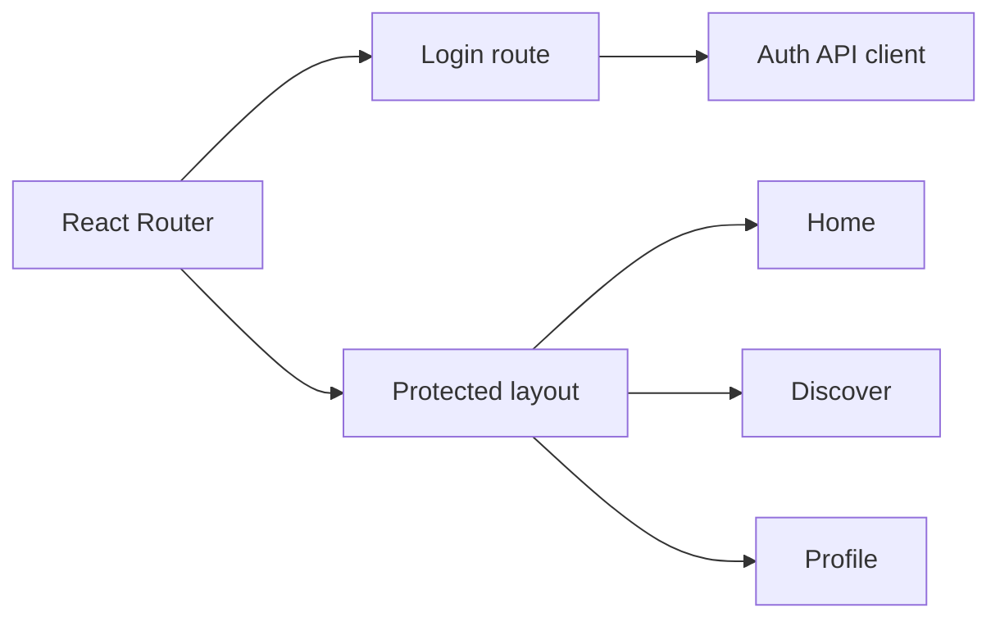

# Gezzenti frontend prototype

This repository contains an early React/TypeScript frontend prototype for Gezzenti.
It is **not** the source of the current production site. The live product is at
[gezzenti.com](https://gezzenti.com/).

The prototype covers login and protected home, discovery, and profile routes.
It uses Vite, React Router, Axios, and a small shared UI layer.



## Local development

```bash
npm ci
npm run dev
```

This repository is retained as a historical prototype; for product information,
see the live site rather than treating these screens as current functionality.
The archived snapshot is not release-ready: its TypeScript build currently fails
because React type declarations are missing.
